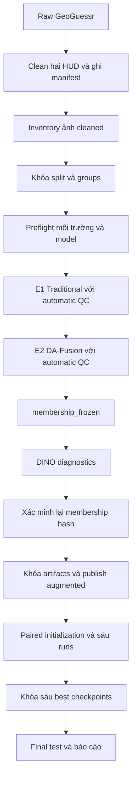

# Kế hoạch triển khai benchmark GeoGuessr-50k

| Mục | Giá trị |
|---|---|
| Benchmark ID | `geoguessr50k_country_augmentation_v1_2` |
| Nguồn yêu cầu | [docs/specs.md](specs.md), v1.2, FROZEN |
| Danh sách thực hiện | [docs/tasks.md](tasks.md) |
| Mục tiêu | Đo thay đổi Macro-F1 và các chỉ số phụ khi bổ sung dữ liệu offline cho minority classes, với cùng thiết lập huấn luyện trên ba seed ghép cặp và cùng validation/test thật. |
| Hiện trạng | Repository hiện có `docs/specs.md`, `docs/plan.md`, `docs/tasks.md` và `.agents/`. Mã nguồn Python và cấu hình chạy thuộc phần triển khai. Raw JPEG tại `data/compressed_dataset/` chỉ được đọc cho cleaning và xác minh provenance; benchmark dùng `data/cleaned_dataset/`. Mọi counts bên dưới là baseline hoặc dự kiến theo spec. |

## 1. Phạm vi và tiêu chí hoàn thành

Benchmark gồm đúng hai condition. `original` dùng `splits/train.csv`. `augmented` dùng `splits/train_augmented.csv`, tập hợp original train và synthetic đã được chấp nhận. Cả hai dùng chung `splits/val.csv`, `splits/test.csv`, mapping, group definitions, kiến trúc, pretrained weights, preprocessing, batch size, loss, optimizer, lịch LR, 20 epochs, checkpoint policy và metrics. Với mỗi seed `42`, `123`, `2026`, hai condition nạp chung một initial state. Ba run `augmented` dùng cùng một manifest offline đã khóa.

Nghiệm thu v1.2 gồm sáu runs ghép cặp, đủ 20 epochs và báo cáo từ predictions của sáu best checkpoints đã khóa. A dùng E0. B_DAFusion dùng E0 + E1 traditional medium + E2 DA-Fusion tail. E3 Geo-adapted DiSC-DS là lựa chọn tail dự kiến cho B_GeoDiSC.

## 2. Bối cảnh kỹ thuật và quyết định triển khai

| Thành phần | Hướng triển khai |
|---|---|
| Runtime | Python, PyTorch, Torchvision và một GPU cho cả sáu runs. Diffusers cho SD 1.5 img2img, frozen `dino_vits16` cho diagnostics. Pillow, NumPy, PyYAML và pytest phục vụ ảnh, cấu hình, kiểm thử. |
| Kiến trúc | Một package `src/geoguessr_benchmark/` và một CLI chạy theo bước. File manifests là giao diện giữa các bước. Training chỉ lấy ảnh từ manifest và dùng mapping đã khóa. |
| Định dạng | UTF-8, filepath tương đối từ project root với dấu `/`. CSV header cố định, UTF-8/LF. JSON/JSONL chuẩn, trường lồng nhau là JSON, giá trị thiếu là `null` trong JSON hoặc ô trống trong CSV. Dữ liệu và artifact giữ tên trường tiếng Anh. |
| Kiểm chứng | Tiny fixtures chạy local, CUDA preflight dùng model thật và không đọc score val/test. Các số về versions, revision, checksum, batch size thực tế và thời gian do preflight/run ghi nhận. |

Khung thực thi trong [tasks.md](tasks.md) dùng checklist ID, phụ thuộc và mốc nghiệm thu theo từng nhóm việc. Repository hiện chưa có `.specify/`, constitution, scripts setup hay templates tương ứng. Data contracts và hướng dẫn chạy được ghi ngay trong kế hoạch này để cặp tài liệu dùng được cùng `docs/specs.md`.

### Mặc định triển khai đề xuất

- Dùng `pyproject.toml` cho package và dependencies, `argparse` cho CLI, Pillow/libjpeg cho decode và JPEG, các phép ảnh RGB số thực qua NumPy/Torch/Torchvision dưới backend đã pin. Chốt cách encode/hash canonical trước khi có artifact đầu tiên. Với decoded-pixel hash, tuần tự hóa chiều rộng và chiều cao dưới dạng hai số nguyên không dấu 32-bit big-endian, rồi nối bytes RGB uint8 theo thứ tự hàng. Cùng helper được dùng cho ảnh real và synthetic.
- Dùng một tiến trình ghi tại mỗi stage, kích hoạt bằng cập nhật lock sau cùng. Ghi file qua tệp tạm cùng filesystem và publish bằng rename. Khi gián đoạn, kiểm tra phần đã lưu theo ID, trạng thái và checksum trước khi tiếp tục. Chỉ stage đã publish đầy đủ mới được bước sau sử dụng.
- Giữ seed, source và thứ tự attempt theo spec. Xử lý E1 trước E2, rồi theo `(class_id, attempt_index)` trong mỗi pool. `synthetic_id` là SHA-256 của `<benchmark_id>|<augmentation_type>|<class_id>|<attempt_index>` UTF-8. Top-5 dùng raw logits và Top-1 theo cùng thứ tự xếp hạng.

### Cấu trúc mã nguồn đề xuất

Các đường dẫn trong bảng tính từ thư mục `GeoLocation_DataPreprocessing/`. Các artifact benchmark giữ đúng vị trí theo §16 của spec.

| Đường dẫn | Trách nhiệm |
|---|---|
| `pyproject.toml`, `.gitignore`, `tests/` | Môi trường cài đặt, bỏ qua dữ liệu thô/checkpoints/cache khi dùng Git và các fixtures kiểm thử. |
| `src/geoguessr_benchmark/__main__.py`, `config.py` | CLI theo stage, đọc bộ cấu hình và bảo vệ giá trị cố định. |
| `src/geoguessr_benchmark/artifacts.py`, `images.py` | Canonical CSV/JSON/hash và kiểm tra lock. Decode EXIF→RGB, pixel hash, JPEG và geometry letterbox dùng chung. |
| `src/geoguessr_benchmark/cleaning.py` | Che hai HUD cố định theo resolution, lưu JPEG native và manifest raw/cleaned. |
| `src/geoguessr_benchmark/inventory.py`, `split.py` | Inventory, mapping, deterministic split, duplicate audit, group budgets và evaluable IDs. |
| `src/geoguessr_benchmark/classifier.py`, `preflight.py` | Preprocessing classifier, model, optimizer dùng chung với preflight, model snapshots, environment lock và CUDA checks. |
| `src/geoguessr_benchmark/augmentation/policy.py`, `traditional.py`, `diffusion.py` | Source/attempt/seed policy, traditional transforms và SD img2img content-only. |
| `src/geoguessr_benchmark/augmentation/qc.py`, `review.py`, `diagnostics.py`, `workflow.py` | QC và audit leakage, nhập review người, DINO diagnostics, orchestration và freeze union. |
| `src/geoguessr_benchmark/metrics.py`, `training.py`, `experiment.py` | Metrics chung, epoch/checkpoint logic, paired initialization, ma trận sáu runs và khóa train hoàn tất. |
| `src/geoguessr_benchmark/evaluate.py`, `reporting.py` | Final inference, tính lại metrics từ predictions, paired aggregation và báo cáo. |

## 3. Trình tự dữ liệu và điều kiện chuyển bước



| Mốc | Bằng chứng để chuyển bước | Việc bị chặn nếu thiếu bằng chứng |
|---|---|---|
| Cleaning | Raw giữ nguyên, JPEG cleaned giữ dimensions và path, che đúng bbox và có provenance. | Inventory. |
| Inventory và split | Dataset cleaned đúng baseline bắt buộc, mapping nhất quán, split deterministic, counts/support đã đối chiếu, audit IDs/hashes đạt. `benchmark_lock.json` ghi checksum split đã chốt. | Preflight benchmark và mọi generation chính thức. |
| Environment và model preflight | `environment.lock.txt`, resolved revisions/hashes, config có batch size hiệu lực, kiểm tra deterministic FP32 trên đúng GPU, img2img thật batch 1 trên cleaned train source có padded canvas lớn nhất. | Generation chính thức. |
| Accepted và dataset freeze | Đủ quota và qua QC, provenance và hash audits. `augment-freeze` chạy DINO sau `membership_frozen`, xác minh hash rồi publish E1/E2, train union và lock. | Initialization và sáu main runs. |
| Kiểm chứng trước main training | Tiny fixtures theo §17 gồm geometry, metrics, grouping, aggregation, leakage và pairing. Ba file init khớp giữa A/B từng seed. Verify config chung, splits và frozen artifacts. | Main training. |
| Train hoàn tất | Ma trận đúng sáu runs. Tất cả đủ 20 epochs, hash của best checkpoints và validation-at-best đã được khóa. | Final test inference. |
| Final test và report | Sáu predictions files đủ ảnh, đúng hash checkpoint và manifest. Aggregate từ artifacts và đối chiếu checklist §20. | Công bố kết quả benchmark. |

### Cấu trúc lock và xử lý cập nhật

- `benchmark_lock.json` tiến theo stages `splits → preflight → membership → augmented → initialized → trained → tested → reported`. Ghi benchmark ID/schema, dataset fingerprint, SHA-256 của manifests/mapping/groups/configs/spec/environment và các model artifacts theo stage. Các mốc `initialized`, `trained` và `tested` lần lượt khóa ba `seed_<seed>.pt`, sáu best checkpoints và sáu predictions files. `verify` so file với giá trị đã khóa. Train/eval phải tự gọi xác minh bắt buộc mỗi lần chạy hoặc resume.
- Ở `splits`, khóa nguyên bytes của cleaned train/val/test, cleaning manifest, mapping, inventory và toàn bộ assignment/target/budget trong `class_groups.csv`. `accepted_actual` khởi tạo bằng 0. Lưu hash group file ban đầu, hash của các cột group bất biến và hash `split_metadata.json` ban đầu. Ở `augmented`, chỉ cập nhật `accepted_actual` từ accepted manifest và checksum của `class_groups.csv` trong `split_metadata.json`. Giữ bằng chứng hash cũ trong lock và đối chiếu lại hash cột bất biến. Membership/counts gốc, seed, evaluable IDs và các manifest real giữ đồng nhất ở hai mốc.
- E1 và E2 tự động nhận candidate qua QC, rồi khóa stage `membership` với `augmentation_policy: automatic_qc_v1`. Hash ghi ID, source ID, output hashes và acceptance. DINO và review định tính nằm ngoài phép hash.
- `augment-freeze` xác minh stage `membership` và hash đã khóa, rồi gọi `log_dino_diagnostics(root)`. Tính lại projection từ trạng thái sau diagnostics và yêu cầu `membership hash before DINO == membership hash after DINO`. Sai lệch chặn publish. Sau khi xác minh, khóa bytes của `candidates.jsonl` và provenance liên quan, publish `augmentation/manifests/accepted.jsonl`, `augmentation/manifests/qc_summary.json` và `splits/train_augmented.csv`, rồi ghi final lock stage `augmented` sau cùng. Giữ checksum ảnh đã chấp nhận và đối chiếu nội dung file trước khi dùng. Khi cập nhật nhiều file, giữ metadata của lần publish gần nhất cùng checksum bytes đã stage. Lần chạy lại đối chiếu lock, hoàn tất publish đang dở nếu toàn bộ staging hợp lệ hoặc khôi phục bản đã commit. Các incident, shortage và lỗi hạ tầng ghi vào audit hoặc run metadata tương ứng.

## 4. Inventory, split và group budgets

### Inventory và chống leakage

1. Chạy `clean` để ghi `data/cleaned_dataset/` và `reports/cleaning_manifest.json` theo §2. Inventory và split xác minh mapping 1:1, membership, dimensions, file và pixel hashes của cả raw lẫn cleaned. Thư mục cleaned và manifest phải cùng tồn tại; nếu phát hiện publish dở, dừng và chạy lại ở run root mới. Tạo `splits/class_to_idx.json` theo thứ tự Unicode code point, ID 0 đến 123. Ghi `reports/dataset_inventory.csv`, `image_id = SHA256(raw_path UTF-8)` theo cleaning manifest; `filepath` luôn trỏ đến ảnh cleaned. Tính `sha256` trên bytes của JPEG cleaned và `decoded_pixel_sha256` trên oriented RGB có dimensions. Fingerprint là SHA-256 của inventory canonical sắp theo filepath, bỏ timestamps khỏi nội dung hash.
2. Đối chiếu 49.997 JPEG, 124 classes, hai nhóm resolution 49.942 ảnh `1536×662` và 55 ảnh `1030×703`, United States 12.014 và minimum class size 1 gồm Antarctica. Ghi nhận sai lệch đối chiếu. Dừng preflight khi ảnh không đọc được, số ảnh/classes lệch hoặc mapping mâu thuẫn. Mọi ảnh gốc chỉ được đọc.
3. Kiểm tra cả file hash và decoded-pixel hash. Duplicate có nhãn mâu thuẫn hoặc nằm khác split làm dừng freeze và được ghi trong `reports/split_audit.json`. Nhóm duplicate theo hash raw được xếp cùng split như v1.1, giữ quota từng lớp. Nếu không xếp được hoặc audit phát hiện hash cleaned giao giữa các split đã xác định, dừng mà không đổi assignment. Khi có panorama/location metadata, audit near/same panorama và nearby captures. Nếu metadata vắng, báo giới hạn của exact-duplicate audit.
4. Dùng `split_seed=42` và sort từng class theo `(SHA256("split-v1|42|" + raw_path), raw_path)`. Với `n≥10` lấy `q=max(1,floor(0.1*n+0.5))`, lần lượt `n-2q/q/q`. Với `3≤n≤9` lấy `n-2/1/1`, `n=2` lấy `1/0/1`, `n=1` lấy `1/0/0`. CSV các split theo `(class_id, filepath)`. Freeze evaluable IDs từ real support. Các bước trước final test chỉ dùng holdout cho lập split, checksum, audit leakage cơ học và metadata hỗ trợ metric.

| Split | Real images dự kiến | Evaluable classes dự kiến |
|---|---:|---:|
| Train | 39.978 | 124 |
| Validation | 5.007 | 106 |
| Test | 5.012 | 111 |

### Frequency groups theo original train count `n_c`

| Group | Quy tắc và target/class | Classes | Real train | Accepted cần thêm | B total |
|---|---|---:|---:|---:|---:|
| `many` | `n_c≥100`, giữ `n_c` | 48 | 37.662 | 0 | 37.662 |
| `medium` | `20≤n_c≤99`, traditional đến 100 | 36 | 2.087 | 1.513 | 3.600 |
| `tail` | `n_c<20`, diffusion đến `min(100,5*n_c)` | 40 | 229 | 916 | 1.145 |
| Tổng dự kiến | `required_accepted = target_c - n_c` | 124 | 39.978 | 2.429 | 42.407 |

Singleton có 1 real + 4 synthetic. Test biên `n_c=19,20,99,100` cho `(group,target,budget)` lần lượt `(tail,95,76)`, `(medium,100,80)`, `(medium,100,1)`, `(many,100,0)`. Evaluable classes theo nhóm Many, Medium, Extreme Tail dự kiến `48/36/22` trên validation và `48/36/27` trên test. Báo số thực tế từ manifest.

## 5. Sinh và kiểm định dữ liệu offline

### Giao thức chung

`augmentation_seed=314159`. Sort nguồn cleaned original train theo filepath trong từng class. Attempt `j` dùng `source[j % n_c]` và 32 bit đầu big-endian của `SHA256("aug-v1|314159|augmentation_type|class_id|j")`. Candidate đạt QC tăng accepted count. Nếu bị reject thì tiếp tục đến đủ quota hoặc cap `10 * required_accepted` của class. Hết cap thì ghi shortage và chặn freeze.

Lưu final RGB JPEG quality 95, subsampling 0, bỏ EXIF. Decode JPEG cuối để QC và ghi pixel hash. Lưu mọi attempt và giữ file diffusion đọc được đến khi ghi xong diagnostics. Resume kiểm tra lịch sử theo thứ tự, giữ ID/seed và xác minh ảnh đã accepted. Training đọc union manifest đã khóa.

### Traditional cho `medium`

Áp lên oriented RGB ở resolution gốc. Chọn đều `k∈{1,2}`, lấy `k` transform khác nhau, áp đúng thứ tự bảng sau và clip `[0,1]` sau từng transform. Quantize khi cần encode, lưu thứ tự, giá trị đã sample và pin backend/rounding.

| Thứ tự | Transform | Phân bố/thuật toán |
|---:|---|---|
| 1 | Brightness | RGB nhân `U(0.90,1.10)` |
| 2 | Contrast | Blend quanh mean grayscale với factor `U(0.90,1.10)` |
| 3 | Gamma | `x**gamma`, `gamma ~ U(0.90,1.10)` |
| 4 | Gaussian noise | RGB độc lập, mean 0, `sigma ~ U(1,3)/255` |
| 5 | Gaussian blur | Kernel `5×5`, `sigma ~ U(0.10,0.60)` pixel |
| 6 | Small rotation | `U(-3,+3)` độ, bilinear, reflection padding |
| 7 | JPEG variation | JPEG encode/decode trung gian, quality nguyên đều `[85,95]` |

Ảnh traditional giữ kích thước gốc và chỉ qua automatic QC gồm decode/RGB/dimension, non-blank, provenance và exact duplicate. Danh sách transform cho phép gồm đúng bảy phép trên.

### DA-Fusion-inspired img2img cho `tail`

- `augmentation_type=da_fusion`, `method_variant=sd15_img2img_fixed`. Dùng snapshot bất biến của `stable-diffusion-v1-5/stable-diffusion-v1-5`, `StableDiffusionImg2ImgPipeline`, `DDIMScheduler` lấy config từ snapshot. `strength=0.35`, `guidance_scale=5.0`, `num_inference_steps=40`, `eta=0.0`, batch 1, một ảnh/prompt, FP32, standard attention, `xformers=false`. Log timestep schedule thực tế. Pipeline giữ safety checker của snapshot. `safety_flag` là lý do reject khi checker báo flagged. Phiên bản này dùng img2img fixed, không LoRA, textual inversion, diffusion fine-tuning, mixed precision hay quantization.
- Copy trọn positive/negative prompt ở §7.2 của spec vào `augmentation/da_fusion/config.yaml`. Chỉ thay `{class_name}` bằng tên thư mục. Giữ prompt và rubric độc lập khỏi val/test và classifier scores.
- Dùng cleaned train RGB native. Reflection-pad tối thiểu đến bội số 8, phần lẻ ở right/bottom. Lưu source content dimensions, canvas thực, half-open bbox, offsets và output dimensions. Crop đúng một lần để JPEG content-only giữ nguyên native size.

| Cleaned source | Native-padded canvas | `source_bbox` trên canvas | Output JPEG | Classifier input |
|---|---|---|---|---|
| `1536×662` | `1536×664` | `[0,1,1536,663]` | `1536×662` | `3×160×384` |
| `1030×703` | `1032×704` | `[1,0,1031,703]` | `1030×703` | `3×160×384` |

### Ranh giới QC, review và diagnostics

| Bước | Quy tắc nghiệm thu |
|---|---|
| QC cho cả hai | Decode JPEG RGB hợp lệ, dimensions đúng theo phương pháp, không NaN/Inf. Trên grayscale uint8 vùng content, std `≥5` và phần pixel `≤2` hoặc `≥253` phải `<0.98`. Source, hash, label, transform/config provenance khớp policy. Exact-pixel duplicate với source, original train hoặc synthetic đã accepted bị reject. Collision file/pixel hash với holdout tạo incident và chặn freeze. |
| QC thêm cho diffusion | Canvas, bbox, padding và output native phải khớp geometry từ cleaned source. Đo blur trên JPEG content-only và cleaned source native, đưa cả hai về long edge 384 chỉ cho metric. Laplacian `[[0,1,0],[1,-4,1],[0,1,0]]`, reflect boundary, grayscale `[0,255]`. Điều kiện `var(output) ≥ max(5, 0.5*var(source))`. QC và hashes sử dụng file đã crop theo §7.2. |
| Review định tính tùy chọn | So cleaned train source với final JPEG để ghi chú về cue địa lý và artifact. Annotations được lưu riêng khỏi benchmark membership. |
| DINO sau chốt membership | Frozen `dino_vits16` với code commit và weights SHA bất biến. So cleaned source native với final output decode. Letterbox toàn content `224×224`, bilinear antialias, padding/normalize ImageNet, lấy global embedding L2-normalized. Log cosine source và cosine/ID gần nhất trong các diffusion siblings accepted cùng source, loại chính candidate. Áp dụng cho accepted và rejected đọc được. Thiếu sibling ghi `null` và lý do. Lỗi embedding của từng candidate đọc được ghi `null` cho trường bị ảnh hưởng và `dino_diagnostic_error`. Diagnostics chỉ ghi metadata, giữ nguyên trạng thái accepted/rejected. |

Automatic QC dùng reason enums §8.2. Geographic cue change và ambiguous là lý do ghi chú định tính. DINO ghi diagnostic fields sau khi đủ quota và khóa membership.

### Gói duyệt diffusion offline

`review-export` tạo `augmentation/review/` gồm `index.html`, `review_queue.jsonl`, `sources/` và `generated/`. Gói gồm các cặp diffusion qua automatic QC, trỏ tới bản copy nguyên bytes của cleaned train source và final native JPEG.

Mỗi cặp hiển thị class name, `synthetic_id`, `attempt_index`, hai ảnh, `source_sha256`, `output_sha256` và rubric theo §7.3. Bộ điều khiển gồm **Accept**, **Reject — geographic cue changed**, **Reject — generation artifact** và **Reject — ambiguous**. Lựa chọn reject lần lượt xuất `geographic_cue_changed`, `generation_artifact` và `reject_ambiguous`. Payload của UI chỉ gồm ảnh source train, ảnh diffusion cuối, định danh class/provenance và rubric. Giữ ảnh validation/test, classifier scores, predictions và DINO scores ngoài gói và UI.

Reviewer tải `reviews.jsonl` gồm ID, source/output hashes, rubric, ghi chú và timestamp UTC. Import đối chiếu candidate và bytes ảnh rồi lưu annotations. Luồng generation, freeze và training chạy độc lập với các file review.

## 6. Hợp đồng artifacts

| Artifact | Trường chủ chốt và kiểm chứng |
|---|---|
| `reports/cleaning_manifest.json` | ID, cleaning policy, class/path raw và cleaned, dimensions, bbox và hash file/pixel của cả hai. |
| `reports/dataset_inventory.csv`, `reports/split_audit.json` | Inventory `image_id,filepath,class_name,class_id,width,height,bytes,sha256,decoded_pixel_sha256,readable`. Audit ghi baseline, lỗi đọc ảnh, duplicate/leakage, metadata địa lý nếu có và counts/support thực tế. |
| `splits/{train,val,test}.csv`, `splits/class_to_idx.json`, `splits/class_groups.csv` | CSV `image_id,filepath,class_name,class_id,split,sha256,decoded_pixel_sha256,is_synthetic`. Tất cả original rows có `is_synthetic=false`. Mapping 124 IDs nối tiếp. Groups dùng `class_id,class_name,original_train_count,group,target,required_accepted,accepted_actual`. |
| `splits/split_metadata.json` | Schema version, seed, hash order/tie-break, allocation policy, dataset fingerprint, class/split counts, evaluable IDs và từng manifest/map/group SHA. |
| `augmentation/manifests/{candidates,accepted,accepted_traditional,accepted_da_fusion}.jsonl` | §9 của spec liệt kê schema và provenance. Candidate records dùng policy `automatic_qc_v1`. Accepted E1/E2 pool manifests tham chiếu JPEG hiện có theo phương pháp. `splits/train_augmented.csv` hợp E0, E1 và E2 cho B_DAFusion. |
| `augmentation/manifests/qc_summary.json`, `splits/train_augmented.csv` | QC summary có attempts/accepted/rejected, reasons, target/coverage theo class và phương pháp, shortage/incident khi có. Augmented union cùng schema split gốc, synthetic `image_id=synthetic_id`, hashes lấy từ output, `split=train`, `is_synthetic=true`. Original rows xuất hiện đúng một lần. |
| `configs/benchmark.yaml`, `augmentation/{traditional,da_fusion}/config.yaml`, `environment.lock.txt`, `benchmark_lock.json` | Fixed values theo §6–§11. Môi trường ghi OS, Python/packages, versions/hashes khi có, image backend/rounding, GPU/driver/CUDA/cuDNN, source Git commit hoặc archive hash, các pretrained artifacts và immutable revisions. |
| `initializations/seed_<seed>.pt`, `runs/{original,augmented}/seed_<seed>/` | Init hash dùng chung theo seed. Mỗi run ghi `config.yaml`, `metrics.json`, `history.csv`, `best_checkpoint.pt`, `last_checkpoint.pt`, `confusion_matrix_val.csv`, `confusion_matrix_test.csv`, `per_class_metrics_val.csv`, `per_class_metrics_test.csv`, `group_metrics.json`, `predictions_test.csv`, `run_metadata.json`. Thêm `lr_steps.csv` để lưu LR trước từng optimizer step theo §11.1. |
| `reports/per_seed_metrics.csv`, `reports/aggregate_metrics.json`, `reports/group_comparison.csv`, `reports/final_report.md` | Raw per-seed, aggregate số thực, support/group comparisons, per-class và paired changes, appendix per-seed và diễn giải tiếng Việt theo §15 và §18. Các bảng test dẫn tới checkpoint và prediction đã khóa. |

**Trường bắt buộc của một candidate theo §9**

| Nhóm | Trường |
|---|---|
| Identity và source | `benchmark_id`, `synthetic_id`, `synthetic_path`, `source_image_id`, `source_image_path`, `source_sha256`, `class_name`, `class_id`, `source_split` |
| Generation | `augmentation_type`, `method_variant`, `augmentation_parameters`, `augmentation_seed`, `generation_seed`, `attempt_index`, `generation_timestamp` |
| Geometry diffusion | `source_content_width`, `source_content_height`, `generation_canvas_width`, `generation_canvas_height`, `source_bbox`, `padding_mode`, `padding`, `output_content_only` theo §7.2 |
| QC | `filter_status`, `filter_reason`, `accepted`, `rejection_reason`, `qc_passed`, `qc_scores` |
| DINO | `dino_source_similarity`, `dino_nearest_sibling_similarity`, `dino_nearest_sibling_id`, `dino_diagnostic_error` |
| Output và lock | `output_width`, `output_height`, `output_sha256`, `output_pixel_sha256`, `config_sha256`, `environment_lock_sha256` |

| Giao diện nội bộ | Đầu vào và kết quả |
|---|---|
| `clean_dataset(root)` → `build_inventory(root)` → `build_split(root)` | `root` là project path. Split dùng inventory/mapping đã tạo và xuất ba real manifests cùng audit, groups và lock. |
| `prepare_generation_canvas(rgb)` → `crop_generated_content(canvas, geometry)` | Đầu vào là cleaned RGB native. Hàm crop đối chiếu kích thước canvas đã decode và geometry rồi trả RGB native content để lưu JPEG. |
| `check_candidate(root, candidate, source, config, hash_index)` | Kiểm tra candidate, source, config và indexes của các real splits và accepted outputs. Trả trạng thái QC, reason, scores và holdout incident. Workflow lưu acceptance tự động. |
| `evaluate_predictions(rows, evaluable_ids, class_groups)` | Prediction rows gồm true/predicted IDs và top-5 IDs. Trả metrics tổng, full confusion, per-class rows và group metrics. Validation và final test dùng chung logic này. |
| `load_test_predictions(root, condition, seed)` | Đọc predictions đã xác minh theo `image_id` và run identity, dùng lại cho `build_report(root)`. Báo cáo chỉ aggregate khi lock đạt `tested`. |

## 7. Preflight, preprocessing và huấn luyện

### CUDA preflight và tái lập

- Resolve SD model commit và hash weights, tokenizer, VAE, scheduler config và snapshot artifacts cần nạp. Pin DINO code commit/weights và EfficientNet pretrained SHA. Dùng snapshot local theo immutable identities khi chạy. Thử img2img thật trên cleaned train source có padded canvas lớn nhất. Xác minh FP32, standard attention, batch 1, native pad /8 và crop về native size. CUDA OOM làm dừng preflight và báo geometry. Ghi các thuộc tính đã kiểm, hardware và kết quả probe trong phần preflight của lock. Preflight output tách khỏi candidate log và quota.
- Chọn batch size một lần, thử `128 → 64 → 32 → 16 → 8 → 4 → 2` chỉ khi CUDA OOM. Dùng input shape thật, EfficientNet-B0 FP32, forward/backward/AdamW step để cấp phát state. Lỗi ngoài OOM hoặc OOM ở 2 làm preflight fail. Reset model/optimizer/RNG sau thử, khóa batch size hiệu lực trước generation. Nếu main run OOM, ghi sự cố và phục hồi đúng cấu hình hoặc áp dụng policy phiên bản mới của §11.1 cho cả comparison.
- `CUBLAS_WORKSPACE_CONFIG=:4096:8` trước CUDA init, `torch.use_deterministic_algorithms(True)`, cuDNN benchmark off/deterministic on, TF32 off ở matmul/cuDNN. Lỗi deterministic làm preflight dừng. Set `PYTHONHASHSEED` khi gọi subprocess từng seed, seed Python/NumPy/PyTorch CPU/CUDA, DataLoader generator và worker seed `initial_seed % 2**32`. Evaluation dùng RNG riêng. GPU model, driver và software lock giống nhau giữa sáu run.

### Classifier và lịch train

Classifier preprocessing decode → EXIF transpose → RGB float `[0,1]` → resize bilinear antialias theo geometry ở §10 → center pad RGB ImageNet mean `(0.485,0.456,0.406)` → normalize trừ mean và chia std `(0.229,0.224,0.225)`. Padding sau normalize bằng zero. Output shape `float32 [3,160,384]`. Áp chung cho ảnh thật, traditional và generated content-only crop, mọi split. Classifier nhận JPEG content-only đã lưu và letterbox lại bằng ImageNet mean.

| Thành phần | Cấu hình cố định |
|---|---|
| Kiến trúc | `torchvision.models.efficientnet_b0` + `EfficientNet_B0_Weights.IMAGENET1K_V1`; dropout `0.2`, head `1280→124`, PyTorch Linear Kaiming uniform `a=sqrt(5)`, bias `±1/sqrt(1280)`. Fine-tune toàn backbone, BatchNorm ở train mode khi train. |
| Optimizer và loss | AdamW `lr=0.0003`, `weight_decay=0.0001` cho toàn bộ params trainable, `betas=(0.9,0.999)`, `eps=1e-8`. Mean CrossEntropy, smoothing `0`, class weights `null`, gradient accumulation `1`, clipping `null`. Classifier FP32, AMP off. |
| DataLoader | Train shuffle không replacement và mỗi record đúng một lần mỗi epoch. `drop_last=false`, 4 workers, pin memory true, persistent workers false, common batch size. Dùng preprocessing deterministic và loss/sampler đã định ở §11. |
| LR | `L=ceil(train_size/batch_size)`, `u=k/L`, `k=0..20L-1`. Trước optimizer step, dùng `base_lr*(0.1+0.9*u)` khi `u<1`, còn lại `min_lr+0.5*(base_lr-min_lr)*(1+cos(pi*(u-1)/19))`, `min_lr=1e-6`. Log từng step và epoch. |
| Training | 20 epochs mỗi run, val mỗi epoch ở `model.eval()` và no-grad/inference. Chọn max `val_macro_f1_evaluable` chưa làm tròn, giữ epoch sớm nhất khi hòa. Khôi phục train mode cho epoch tiếp theo. Validation dùng để monitor và chọn checkpoint, cấu hình đã khóa được dùng hết 20 epochs. |

| Thứ tự | Condition | Seed | Train manifest |
|---:|---|---:|---|
| 1 | `original` | 42 | `splits/train.csv` |
| 2 | `augmented` | 42 | `splits/train_augmented.csv` |
| 3 | `original` | 123 | `splits/train.csv` |
| 4 | `augmented` | 123 | `splits/train_augmented.csv` |
| 5 | `original` | 2026 | `splits/train.csv` |
| 6 | `augmented` | 2026 | `splits/train_augmented.csv` |

Mỗi seed tạo một initial state trên pretrained backbone và head mới trong RNG context của seed đó, lưu `initializations/seed_<seed>.pt` rồi verify SHA trước khi cả A/B nạp. Shared config hash loại đúng các trường được phép khác tại §17, gồm condition, seed, paths, train manifest hash, dataset counts và runtime metadata. Đối chiếu riêng split/map/group/preprocessing/checkpoint policy hashes của cả sáu run và init hash theo cặp.

Best/last checkpoint lưu epoch, model/optimizer/scheduler state (kể cả step counter của scheduler), RNG gồm train loader generator, config và data/init hashes. Resume từ epoch boundary với input hashes trùng, khôi phục RNG trước epoch kế tiếp. Ghi checkpoint, best pointer và log theo cùng epoch đã commit. Khi resume, đối chiếu `history.csv`/`lr_steps.csv` với epoch cuối đã commit và phục hồi bản best tương ứng trước khi tiếp tục. Lưu train loss sample-weighted, val loss/metrics, LR, steps, duration và metadata/hashes theo §16. Validation confusion/per-class artifacts mô tả best epoch. Các lỗi/retry ghi vào `run_metadata.json`.

## 8. Evaluation, so sánh và diễn giải

- Khóa đúng sáu best checkpoint hashes trước final test. Dùng chung manifest test real, model ở `eval()` và inference mode. Với mỗi best checkpoint, lưu một bộ predictions final có `image_id`, `true_class_id`, `predicted_class_id`, `top5_class_ids`, `top5_scores`. Hai trường top-5 lưu JSON arrays trong CSV. Validate đúng tập IDs, support, labels, class mapping và thứ tự top-5. Publish predictions cùng kết quả xác minh input hashes trước khi tính các metrics dẫn xuất. Khi predictions đã hợp lệ và khớp identity của run, tái tổng hợp từ file. Lỗi hạ tầng ghi vào run metadata và phục hồi với đúng checkpoint, test manifest, config đã khóa.
- Xếp hạng trên đủ 124 logits, hòa ưu tiên class ID nhỏ hơn. Lập confusion matrix `124×124`, row true/column predicted. `E_S` lấy từ real support `>0`, freeze trước train. Macro-F1 primary, Macro Precision và Macro Recall đều lấy mean trên `E_S`. Weighted-F1 theo support. Top-1/Top-5 tính trên toàn split. Prediction vào class support 0 vẫn tạo FN cho true class. Per-class CSV đủ 124 dòng, class support 0 có `evaluable=false`, metrics null/blank, status `not evaluable on this split`.
- Group Macro-F1/Recall tính trên `G ∩ E_S`, từ per-class TP/FP/FN của **full confusion matrix**. FP/FN xuyên group giữ nguyên. Group ghi evaluable count và real sample support. Empty group cho `null`. Nếu trình bày mean per-class accuracy, dùng cùng định nghĩa với group Macro Recall. Bảng ghi rõ 124 classifier classes, evaluable IDs, validation/test evaluable counts và từng support.
- Aggregation bỏ làm tròn trung gian. Mỗi condition có mean và sample std `ddof=1` qua ba seeds. Từng paired delta là `augmented(seed)-original(seed)`, sau đó tính mean/sample std. Bảng hiển thị percentage points (pp) cho delta. Có đủ Top-1/Top-5, Macro-F1 primary, Weighted-F1, Macro Precision/Recall, group F1/Recall, per-class F1/Recall/support/paired changes và raw per-seed appendix. Báo output suy giảm, tăng hoặc gần như giữ nguyên theo thực đo.
- Báo counts per epoch, total optimizer steps, image exposures, tổng training duration, generation attempts/reasons, acceptance và target coverage. Ví dụ theo counts dự kiến, nếu chọn batch 128, A có 313 steps/epoch (6.260 steps/run), B có 332 (6.640 steps/run). Lượt xem ảnh tại 20 epochs lần lượt là 799.560 và 848.140 mỗi run. Bảng kết quả dùng batch size và counts đã khóa lúc chạy.

| Rủi ro cần trình bày theo §18 | Bằng chứng và giới hạn |
|---|---|
| Extreme Tail thiếu support và few-shot test | Báo `not evaluable on this split`, support từng class và số evaluable trong group. Một thay đổi dự đoán có thể chi phối F1 của lớp chỉ có một ảnh test. |
| Label corruption, near-copy, domain gap | Báo automatic QC reasons, exact-dupe audit, DINO diagnostics, acceptance và giới hạn diversity. Phân tích lỗi label định tính nếu có review. |
| Leakage và pretrained overlap | Báo provenance/hashes, panorama/location audit khi có metadata và phần spatial independence hoặc external pretraining overlap chưa xác minh. |
| Evaluable populations khác nhau | Validation và test có tập nhãn có support khác nhau. Báo riêng mỗi tập và giữ 124 logits. |
| Fixed epochs và combined intervention | So sánh whole policy, B có thêm exposure/steps. Group results mô tả kết quả theo tần suất, còn đóng góp riêng của traditional/diffusion nằm ngoài phép so sánh này. |
| Ba seeds trên một split | Std mô tả độ biến thiên qua training seeds trên split cố định. Kết luận giới hạn ở benchmark này, không suy ra statistical significance hoặc độ bất định qua các locations/splits. |

## 9. Hướng dẫn chạy và ưu tiên kiểm chứng

Trình tự hiện tại là T037 clean → inventory → split, T038 GPU preflight, T039 sinh E1 rồi E2 và khóa membership, chạy DINO, publish hai accepted pools và B_DAFusion. Sau đó khóa paired initialization, chạy A/B_DAFusion theo ba seeds, khóa checkpoints, final test và báo cáo paired deltas.

### Dùng lại T037 trên server

Dừng tiến trình T039 cũ trước khi di chuyển artifact. Chạy từ run root, lưu spec cũ đúng bytes đã khóa trước khi cập nhật source. Giữ archive ngoài run root. Nếu đã cập nhật source, lấy lại bản spec chính xác từ commit/archive đã tạo T037. Đối chiếu checksum với lock trước khi dùng.

```bash
set -eu
archive=$(mktemp -d ../geoguessr-t039-legacy.XXXXXX)
cp docs/specs.md "$archive/specs.md"
cp benchmark_lock.json "$archive/benchmark_lock.json"
cp configs/benchmark.yaml "$archive/benchmark.yaml"
if [ -f environment.lock.txt ]; then cp environment.lock.txt "$archive/"; fi
for path in augmentation/manifests augmentation/review* data/augmented_dataset splits/train_augmented.csv; do
    if [ -e "$path" ]; then
        mkdir -p "$archive/$(dirname "$path")"
        mv -- "$path" "$archive/$path"
    fi
done
printf 'Archive: %s\n' "$archive"
```

Sau khi đưa bản code/config/spec đã review vào run root, dùng cùng biến `archive` hoặc gán lại đường dẫn đã in. `refresh-split-lock` xác minh checksum T037 và khóa spec mới. Nếu checksum lệch, khôi phục artifact đúng từ bản đã xác minh trước khi chạy tiếp. GPU preflight cũ đã khóa hash của source/spec nên cần chạy lại T038. Giữ immutable model snapshots đã có. Archive T039 theo hợp đồng cũ để kiểm tra sau, chạy generation mới theo policy tự động.

```bash
set -eu
python -m pip install -e '.[dev]'
python -m pytest -q
python -m geoguessr_benchmark --root . refresh-split-lock --previous-spec "$archive/specs.md"
python -m geoguessr_benchmark --root . verify --stage splits
python - <<'PY'
import csv
from collections import Counter

with open("splits/class_groups.csv", encoding="utf-8", newline="") as file:
    groups = list(csv.DictReader(file))
budget = Counter()
for row in groups:
    budget[row["group"]] += int(row["required_accepted"])
real = sum(int(row["original_train_count"]) for row in groups)
print(f"E0={real}, E1={budget['medium']}, E2={budget['tail']}, B_DAFusion={real + sum(budget.values())}")
PY
python -m geoguessr_benchmark --root . preflight
python -m geoguessr_benchmark --root . verify --stage preflight
python -m geoguessr_benchmark --root . augment
python -m geoguessr_benchmark --root . augment-freeze
python -m geoguessr_benchmark --root . verify --stage augmented
python -m geoguessr_benchmark --root . init
python -m geoguessr_benchmark --root . train-all
python -m geoguessr_benchmark --root . freeze-checkpoints
python -m geoguessr_benchmark --root . test-all
python -m geoguessr_benchmark --root . report
python -m geoguessr_benchmark --root . verify --stage reported
```

### Mở rộng sau benchmark hiện tại

Triển khai E3 theo §7.4 của spec. Tái sử dụng `accepted_traditional.jsonl` và JPEG đã khóa, sinh E3 theo tail quota, rồi freeze union B_GeoDiSC = E0 + E1 + E3. Train/eval bằng cùng protocol và seeds để so sánh B_GeoDiSC với B_DAFusion.
| Tình huống ưu tiên rà soát | Bằng chứng kiểm tra |
|---|---|
| Hai JPEG khác bytes nhưng cùng oriented RGB | T005–T009 phát hiện duplicate theo pixel hash và chặn cross-split hoặc conflicting labels. |
| Crop hoặc padding lẻ ở panoramas | T004, T011, T016–T018 xác minh hai bbox mẫu và nhánh classifier mean-padding, không crop lần hai trong QC/DINO. |
| Review offline, hash ảnh sai hoặc DINO lỗi | T019–T024 kiểm tra mở bundle offline và round-trip JSONL, từ chối hash sai, `augment-freeze` gọi diagnostics trước publish và giữ nguyên membership hash khi từng candidate gặp lỗi DINO. |
| Artifact hỏng hoặc gián đoạn giữa epoch | T028–T031, T036 kiểm tra fail closed khi checksum sai, resume tương thích, không trùng lịch sử. |
| Prediction rơi vào class ngoài group hoặc support 0 | T026–T027, T032–T035 kiểm tra 124 logits, full confusion, evaluable denominator và paired std trên fixtures. |

Toàn bộ đặc tả §1–§20 được truy vết tới task và bằng chứng trong ma trận ở cuối [tasks.md](tasks.md).
